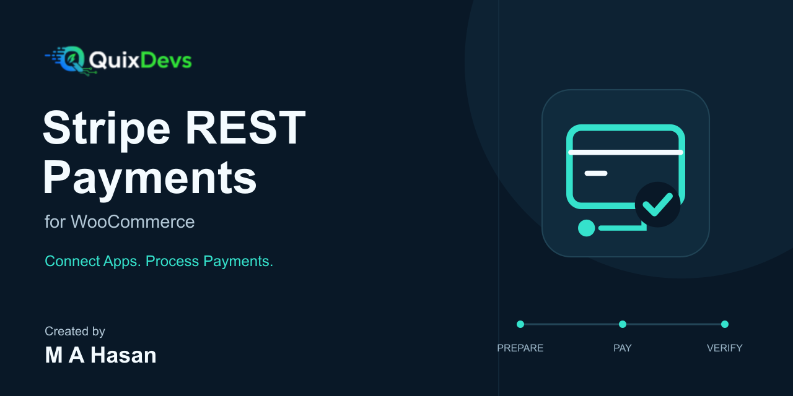
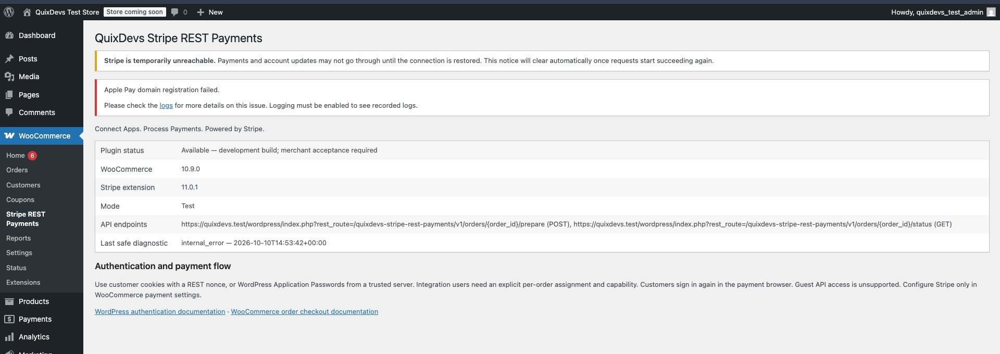
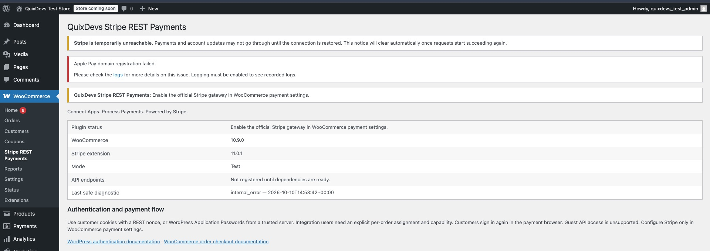
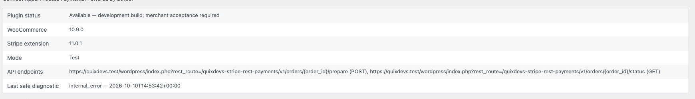
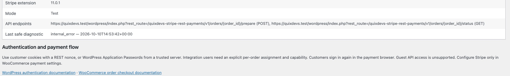

# QuixDevs Stripe REST Payments



**REST API Payment Integration for WooCommerce Stripe**

This plugin extends the official WooCommerce Stripe Payment Gateway to support authorized payment workflows for external web and mobile applications. Prepare an existing customer order through a secure WooCommerce Stripe REST API, open the store's native payment page, and read server-verified payment status.

**Development build — target version 1.0.0.** Merchant Stripe test-mode acceptance and publication checks remain outstanding. See [publication readiness](docs/publication-readiness.md).

Connect Apps. Process Payments.

**[Installation](#installation)** · [Quick start](#quick-start) · [REST API](#rest-api) · [Developer documentation](#developer-documentation)

## Overview

A WooCommerce Stripe API addon for existing-order payments. QuixDevs adds two authenticated endpoints and a small diagnostics screen. The official Stripe extension owns collection, PaymentMethods, PaymentIntents, authentication, settlement, and webhooks. No second gateway or merchant account is created.

## Key Features

- WordPress customer authentication and explicitly scoped server integrations.
- Persistent preparation mutex and per-order idempotency records.
- Verified Stripe payment state, amount, currency, mode and transaction matching.
- Native order-pay browser handoff for WooCommerce mobile payment integration.
- WooCommerce CRUD with legacy storage and HPOS integration coverage.
- Safe errors, no-store responses and minimal admin diagnostics.

Guest API access, embedded Payment Element confirmation, subscription renewals, native SDK payments, and split Stripe gateways are outside this version's scope. Preparation does not create an intent or charge a card. The customer must sign in as the order owner in the browser used for payment.

## Screenshots

All four views are visible below. They show the actual addon on a disposable store using dummy credentials and blocked provider HTTP. Stripe’s connection warnings and the earlier negative-test diagnostic are part of that fixture; these screenshots do not show merchant payment acceptance. [Capture details](docs/screenshots/README.md).

### 1. WooCommerce diagnostics and authentication guidance



### 2. Dependency failure diagnostics



### 3. Versioned API endpoints



### 4. Payment configuration and safe diagnostics



## Requirements

| Component | Required | Locally verified |
| --- | --- | --- |
| PHP | 8.2 or newer | 8.4.13 |
| WordPress | 6.9 or newer | 6.9 |
| WooCommerce | 10.9 or newer | 10.9.0 |
| Official WooCommerce Stripe Payment Gateway | **Exactly 11.0.1**, enabled and configured with cards enabled | 11.0.1 |
| Store transport | HTTPS | Disposable HTTPS fixture |
| Database | WordPress/WooCommerce supported database | MariaDB 10.4.28 |

The exact Stripe pin protects the inspected internal read interfaces. Declared minimums are guards; other combinations and future Stripe versions are not claimed as tested.

## Installation

**Use a staging store while merchant acceptance remains outstanding. No Composer or command-line tools are required on the store.**

1. Install and configure WooCommerce and the official Stripe extension at the required versions.
2. Obtain the installable **`quixdevs-stripe-rest-payments.zip`** development asset from a maintainer. If a GitHub prerelease exists, choose that asset under **Releases → Assets**. GitHub’s automatic source archives contain development files.
3. Open **Plugins → Add Plugin → Upload Plugin**, select the ZIP, install and activate.
4. Open **WooCommerce → Stripe REST Payments** and resolve its diagnostics.
5. Complete the merchant test-mode checklist before considering production use.

Maintainers build the installable ZIP with `python3 tools/package.py` from this repository root. Output: `build/quixdevs-stripe-rest-payments.zip`, plus a SHA-256 manifest. The build uses an allowlist and includes its own production autoloader. Promotional artwork, tests and dependencies stay out of the plugin ZIP.

The historical EventPro implementation is excluded from this repository. Do not activate it alongside this addon; its global function override remains unsafe.

## Quick Start

1. Create an existing, non-guest customer order with a positive total, pending/failed status and payment method `stripe`.
2. Authenticate as the order owner, or use a backend integration identity explicitly assigned to that order.
3. Call `prepare` with an empty body or `{}` and a stable `Idempotency-Key`.
4. Open a returned `checkout_url` in the native payment browser. The customer signs in as the order owner and completes payment using the official gateway.
5. Poll `status` at a bounded rate. Display payment success only when `paid` is `true`.

An existing payment attempt may return pending state with no new URL. Continue its original flow and reconcile uncertain state before retrying. [Request/response contract](docs/rest-api.md) · [Runnable client examples](docs/examples/curl.md).

## How It Works

1. An authenticated caller selects an owned, pending or failed, positive-value order assigned to `stripe`.
2. `prepare` checks authorization and existing payment state under an atomic preparation lock.
3. A fresh order returns its native WooCommerce order-pay URL. The owner opens it, signs in if needed, selects Stripe, and pays using the official checkout UI.
4. Stripe's own browser flow handles customer authentication and its webhook/verification lifecycle updates WooCommerce.
5. The application polls `status` at a bounded rate and displays success only when `paid` is `true`.

## Stripe Configuration

Manage all credentials, test/live mode, enabled methods and webhook settings in the official gateway. QuixDevs stores no additional merchant credentials and changes no webhook configuration. The native payment page can offer other configured gateways; QuixDevs verifies only orders whose current method is `stripe`.

## REST API

Namespace: `quixdevs-stripe-rest-payments/v1`.

| Method | Route | Purpose |
| --- | --- | --- |
| POST | `/orders/{order_id}/prepare` | Authorized native payment handoff |
| GET | `/orders/{order_id}/status` | Read-only verified order/payment state |

POST accepts an empty body or `{}` with a 16–128 character `Idempotency-Key`. No payment method IDs, amount, currency, tokens, raw card data or success flags are accepted. [Complete contract](docs/rest-api.md).

## Authentication

Same-store authenticated browser requests use WordPress cookies plus `X-WP-Nonce`. Trusted backends can use core Application Passwords over HTTPS. A separate integration user must have both the plugin capability and an explicit order assignment. Store credentials only on the backend. [Authentication guide](docs/authentication.md).

## Payment Lifecycle

`requires_action`, `processing`, and `requires_capture` remain pending. Stripe `succeeded` alone does not imply WooCommerce fulfillment or a reconciled paid order. The addon never calls `payment_complete()` or forces processing orders to completed. [Lifecycle](docs/payment-flow.md) · [Idempotency and recovery](docs/payment-idempotency.md).

## API Examples

[cURL](docs/examples/curl.md) · [PHP backend](docs/examples/php.md) · [JavaScript](docs/examples/javascript.md) · [Postman](docs/postman/README.md).

## Ionic Angular Integration

Use your existing authenticated backend to authorize the app's user, prepare the order, and open the native store payment URL in Capacitor Browser. Browser login is separate from app login. Return to the app and check verified status. [Ionic Angular guide](docs/examples/ionic-angular.md).

## Security

This WordPress Stripe REST payments addon rejects anonymous access and cross-customer order access. It never accepts PAN/CVV and never returns client secrets or merchant keys. Exclude these routes and native order-pay pages from caching and URL analytics. [Security policy](SECURITY.md) · [Deployment requirements](docs/security.md).

## Compatibility

HPOS and legacy order CRUD passed real database integration tests for the environment above. Classic/Blocks checkout hooks are left intact, but full checkout payment/browser/webhook acceptance is unverified. There is no second Checkout Blocks registration. [Research and version decisions](docs/stripe-integration-research.md).

## Troubleshooting

Missing routes indicate a dependency, HTTPS or merchant-configuration issue. An existing Stripe attempt yields a pending handoff with no new payment URL; continue the original browser flow and poll status. A persistent preparation lock requires operator reconciliation after stopping workers. Never clear a lock or metadata merely because a client timed out. See [error codes](docs/error-codes.md).

## Verification

Recorded local checks passed: **51 unit tests / 93 assertions**, **18 real WordPress/WooCommerce integration tests / 81 assertions**, legacy and HPOS storage, repeated four-process lock contention, PHPCS, PHPStan level 5, PHP syntax, extracted-package Plugin Check, and Composer-free ZIP installation and lifecycle retention.

Provider HTTP was mocked or blocked throughout. Real Stripe success, decline, 3DS, capture, native browser checkout, webhook recovery, mobile-device return behavior and remote CI execution remain unverified. [Test procedure and environment](docs/testing.md) · [Acceptance status](docs/publication-readiness.md).

## Developer Documentation

- [REST API](docs/rest-api.md), [authentication and scoped integration users](docs/authentication.md), [error codes](docs/error-codes.md)
- [Payment lifecycle](docs/payment-flow.md), [idempotency and lock recovery](docs/payment-idempotency.md), [deployment security](docs/security.md)
- [cURL](docs/examples/curl.md), [PHP](docs/examples/php.md), [JavaScript](docs/examples/javascript.md), [Ionic Angular](docs/examples/ionic-angular.md), [Postman](docs/postman/README.md)
- [Architecture and implementation report](docs/implementation-report.md), [Stripe compatibility research](docs/stripe-integration-research.md), [original source review](docs/original-implementation-review.md)
- [Testing](docs/testing.md), [changelog](CHANGELOG.md), [publication readiness](docs/publication-readiness.md)
- [GitHub listing](docs/github-listing.md), [draft prerelease notes](docs/github-release-notes.md), [publishing checklist](docs/github-publishing-checklist.md)
- [Branding and editable assets](docs/branding/README.md), [WordPress.org asset handoff](wordpress-org-assets/README.md)

For local development:

```sh
composer install
composer test
composer lint
composer analyse
python3 tools/check-source.py
python3 tools/check-repository.py
python3 tools/package.py
```

Integration tests require an explicitly disposable database and WordPress installation. Follow [the testing guide](docs/testing.md) before running `composer test:integration`.

## Contributing

See [CONTRIBUTING.md](CONTRIBUTING.md). The source repository includes development tools; `tools/package.py` builds a production-file-only **development** ZIP.

## License

[MIT](LICENSE) for the new implementation, as requested. The original file says only “MIT License”; it contains no complete grant or ownership notice. Rights/ownership attestation remains a publication prerequisite. No original EventPro code is bundled. See [licensing review](docs/licensing.md).

## 👨‍💻 Developer & Creator

**[Md Abu Hasan (M A Hasan)](https://hasan.online/)**

Full-Stack Software Engineer with **10+ years of experience** building web applications, SaaS platforms, WordPress and WooCommerce plugins, and hybrid mobile applications.

**Technical Expertise:** PHP, Laravel, WordPress, WooCommerce, Ionic Angular, TypeScript, REST APIs, and AI integrations.

- 🌐 **Portfolio & About Me:** [hasan.online](https://hasan.online/)
- 🎓 **Udemy Instructor:** [View Profile](https://www.udemy.com/user/m-a-hasan-2/)
- 🛠️ **Envato Author:** [View Portfolio](https://themeforest.net/user/hasanonline)
- ✍️ **Technical Blog:** [blog.hasan.online](https://blog.hasan.online)

## Maintained by

**QuixDevs**

QuixDevs Stripe REST Payments is developed and maintained under the QuixDevs brand.

Copyright © 2026 QuixDevs.

Independent addon; no official Stripe or WooCommerce endorsement is implied.
